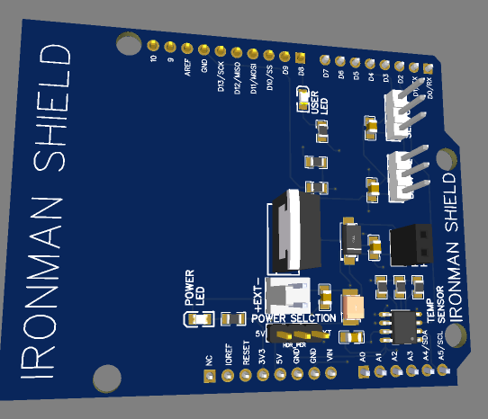
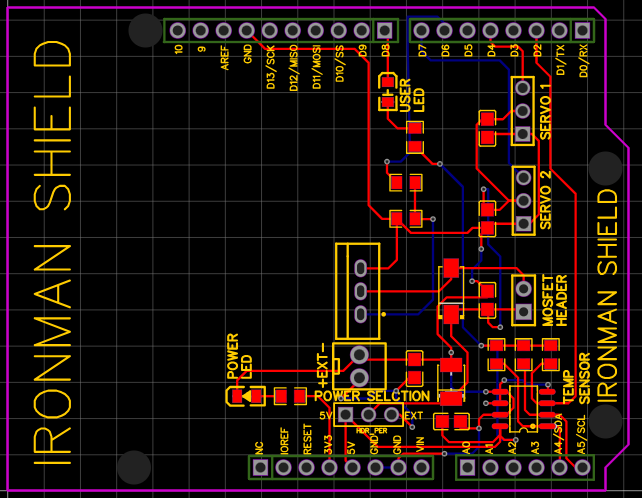
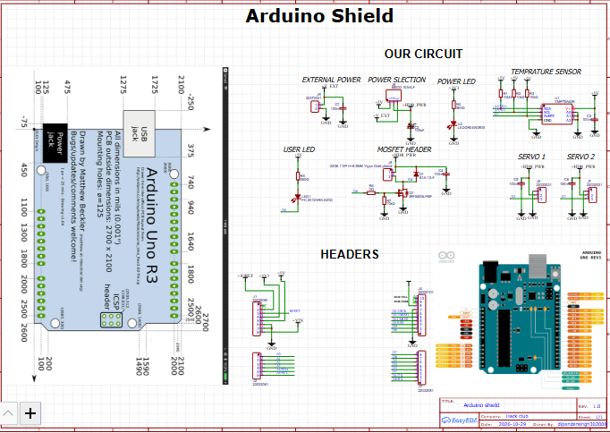

# IRONMAN SHIELD
### Custom Arduino Uno R3 Shield
A custom shield has been designed for Arduino Uno R3.
The shield includes several practical hardware features including temperature
sensing, servo interface, MOSFET interface, indication LEDS and power choice options.

## Demo Video

▶️ [lapse link](https://youtu.be/8z416_anAGs)

## lapse link

▶️ [lapse link](https://lapse.hackclub.com/timelapse/m8AzgBOMNNnI)

## Project
### 3D PCB Representation

### PCB Layout

### Circuit Schematic

## How build physically

### 1. Download the Project

You can download the repository as a ZIP file.

### 2. Load the Design

To open the design:
open easyeda on any browser [EasyEDA](https://easyeda.com/)
Open and upload the schematic and PCB files.

### 3. Manufacture PCB

To make your PCB:

Upload the Gerber Files to a PCB Manufacturer

Place your order.

### 4. Assemble & Test

Once you receive your PCB:
Solder the components onto the board using the schematic & BOM.
Test the Servo & MOSFET interfaces with appropriate external hardware.

## Project Status

Current Deliverables: Schematic, PCB, 3D Model, BOM & Gerber Files.
only virtule project not physical

Designed By: dipender

Project Name: IRONMAN SHIELD

Design Date: 29th October 2026
