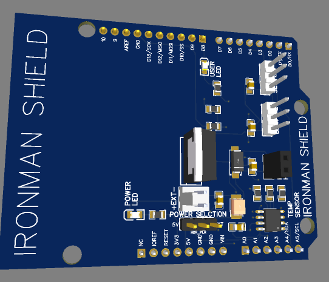
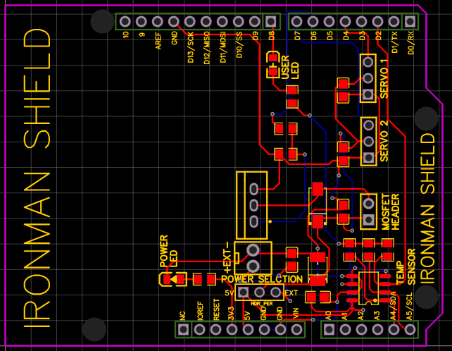
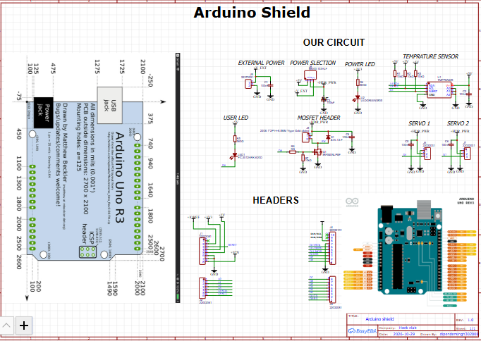

# IRONMAN SHIELD
### Custom Arduino Uno R3 Shield
A custom shield has been designed for Arduino Uno R3.
The shield includes several practical hardware features including temperature sensing, servo interface, MOSFET interface, indication LEDS and power choice options.

## Project Overview
### 3D PCB Representation

### PCB Layout

### Circuit Schematic

## Features
Arduino Uno R3 Compatible
Temperature Sensor
Servo Interface (2)
MOSFET Interface
Power Choice Option
Power Indicator (LED)
User LED
Custom PCB Designed (Schematic, PCB, 3D & BOM)

## Hardware Used

The following components have been used:

| Component | Description |

|---|---|

| Arduino Uno R3 | Main Micro-controller |

| TMP75AIDR | Digital Temperature Sensor |

| IRF540N MOSFET | MOSFET Interface |

| Servo Connectors | Servo Interface (2) |

| User LED | Output LED |

| Power LED | Power LED |

| Capacitors & Resistors | Filtering & Decoupling |

| Pin Headers & Connectors | Arduino & External Connections

See the `BILL OF MATRIAL` folder for full breakdown of components used in the project including footprints, part numbers and links to purchase.

## Tools Used

EasyEDA std was used to design the schematic and PCB.
Gerber Files - For the manufacturing of the PCB.
BOM (CSV File) - For components & sourcing.
3D PCB View - For visualising the PCB.

## How to Get Started

### 1. Download the Project
Run the following to clone the repository:
You can download the repository as a ZIP file.

### 2. Load the Design

To open the design:
Install or open [EasyEDA](https://easyeda.com/)
Open and inspect the schematic and PCB.

### 3. Manufacture PCB

The Gerber Files in the `Gerber file/` folder include:

Board Copper Layers

Solder Mask

Silk Screen

Board Outline

Drills

To make your PCB:

Upload the Gerber Files to a PCB Manufacturer

Place your order.

### 4. Assemble & Test

Once you receive your PCB:
Solder the components onto the board using the schematic & BOM.
Test the Servo & MOSFET interfaces with appropriate external hardware.

##  What I learnt

Designing Schematic
Designing PCB
Creating a Bill of Materials
Reviewing a PCB (2D & 3D)

## Project Status

Current Deliverables: Schematic, PCB, 3D Model, BOM & Gerber Files.
only virtule project not physical

Designed By: dipender

Project Name: IRONMAN SHIELD

Design Date: 29th October 2026
